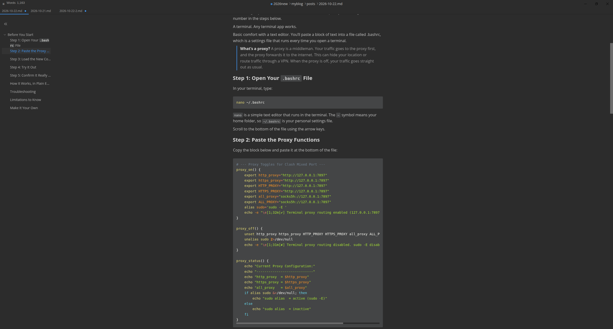

I write my blog posts in Markdown, a simple plain-text format where symbols like `#` for headings and `**` for bold show how the text should look. I wanted an editor that looks similar to **Obsidian**, a popular app for taking notes in Markdown. I started with **Ghostwriter**, a lightweight Markdown editor that was easy to install. On Fedora, a Linux distribution, I only needed to run `sudo dnf install ghostwriter`, and it was ready to use.

Unfortunately, Ghostwriter had several serious display problems on Fedora 44, and they slowed down my writing. So I kept looking for a better option.

Many people wonder why I didn’t simply use Obsidian. Obsidian is an excellent app, and I like it. It organizes everything into “vaults,” which are collections of notes that you can keep in one place. I have also installed a few community plugins to manage attachments and photos, and they work well for notes. However, the way Obsidian organizes vaults doesn’t match how I store my blog posts. What I need is a simple editor where I can open a Markdown file, write for the blog, and not worry about accidentally disrupting my blog’s folder structure.

My search ended with **MarkText**. It is heavier than Ghostwriter, but it does two things I need very well:

- First, its live preview shows the formatted result as I type, so I can see headings, bold text, and links without switching windows. 

- Second, once I add headings, it automatically builds a clickable outline on the left side of the screen. I can jump between sections of a long post with one click, which saves a lot of time.

If you want a Markdown editor that is simple and focused on writing, rather than a full note-taking system like Obsidian, I highly recommend MarkText.

