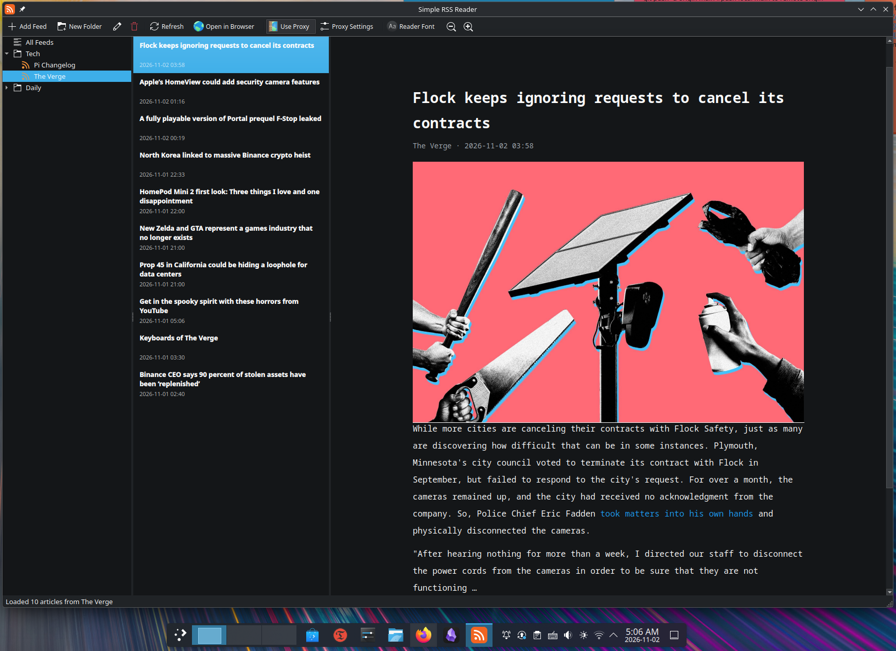

### Hello, Linux community! Introducing my simple RSS reader — built with proxy flexibility in mind.

Hello, people!

After moving to China, I started running into quite a few limitations when using Linux applications, largely due to the Great Firewall (GFW). It made me rethink how I handle network connections on my Linux desktop.

I'm not particularly fond of using TUN mode or system-wide proxy settings on Linux. In my experience, they can sometimes be glitchy, and I don't like the idea of routing all my system traffic through a proxy when only certain applications actually need one.

What I really wanted was something much simpler: **the ability to configure a proxy directly within an application, so that only the traffic from that particular app goes through the proxy, leaving everything else on my system untouched.**

That became the primary motivation behind this little project.

I started developing a simple RSS reader, with one main goal in mind: **making proxy configuration as easy and straightforward as possible.** No need to mess around with system-wide network settings or rely on TUN mode just to get an individual application working.

Along the way, I realized that I also wanted more control over the reading experience. So I added support for custom fonts and font sizes, allowing users to personalize the interface and make reading more comfortable.

And here we are! The first stable version, [Simple RSS Reader v1.0](https://github.com/solar-song/Simple-RSS-Reader), is finally ready.

I've been using and testing it for quite some time, and so far, I haven't run into any new bugs. Of course, there's always room for improvement, and I have plenty of ideas for additional features down the road.

This is a relatively small project, but I built it to solve a problem I personally encountered, and I hope it might be useful to someone else facing similar frustrations.

I'm happy to share it with the Linux community!

If you're interested, give it a try. Feedback, suggestions, and bug reports are always welcome. They will help me make this little application better.

Thanks for checking it out, and happy reading! 
