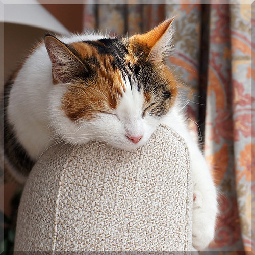

For a long time, I believed that eating healthy was the key to a good night’s sleep. I cleaned up my diet, cut back on late-night snacks, and felt better in many ways. My energy was steadier, my mood was lighter, and I felt more like myself. But my sleep only improved so much. Some nights I still lay awake staring at the ceiling, even on days when I had eaten perfectly.

It took me a while to notice what was missing. The thing that seemed to decide whether I slept well was not what I ate. It was how much I moved.

I don’t mean I suddenly became a gym person. My routine is pretty ordinary. I cook for myself most nights, which means standing, chopping, stirring, and walking back and forth between the counter and the stove. I do my chores by hand instead of putting them off. And when I run out of groceries, I walk about a kilometer to the supermarket and carry everything home. None of these things feels like exercise on its own. But together, they add up to a real amount of movement across the day.

When I started paying attention, I saw the pattern. On days when I was mostly sitting, my sleep was restless and I took longer to drift off. On days when I had cooked, cleaned, and walked to get groceries, I fell asleep more easily and woke up feeling more rested. The more my body was active during the day, the better my nights tended to be.

I’m not a doctor or a sleep researcher, so I can’t tell you this will work the same way for everyone. Sleep depends on many things, including stress, caffeine, screen time, and genetics. This is simply what I noticed in my own life, and it changed how I think about health.

What surprised me most is how small this change was. I didn’t need a new fitness plan or an expensive class. I just needed to stop thinking of movement as something that only happens at the gym. Taking the long way home, carrying my own groceries, and doing the dishes by hand all count.

If you’re struggling with sleep and you already eat well, it might be worth looking at your day from another angle. How much do you actually move between the moments you think of as exercise? You may find, as I did, that the little things add up more than you expect.
